# Cryo Scientific Systems – Sales Workflow Management System

Enterprise Sales Workflow Management System for **Cryo Scientific Systems Pvt Ltd**, governing the complete commercial process from initial inquiry/lead through quotation revision cycles, customer PO verification, and formal sales order handover to production.

---

## 1. Mandatory Workflow Lifecycle

The application enforces the complete 12-stage commercial lifecycle in strict order:

```mermaid
flowchart LR
    A[1. Lead Enquiry] --> B[2. Lead Qualification]
    B --> C[3. Customer Master]
    C --> D[4. Quotation Rev 0]
    D --> E[5. Customer Review]
    E --> F[6. Negotiation & Revisions]
    F --> G[7. Quotation Won]
    G --> H[8. Proforma Invoice]
    H --> I[9. Customer PO Upload]
    I --> J[10. 5-Point PO Verification]
    J --> K[11. Sales Order SO]
    K --> L[12. Production Handover]
```



---

## 2. Mandatory Business Rules & Enforcements

1. **Lead Qualification**: Only qualified leads proceed through quotation drafting.
2. **Quotation Revisions**: Initial quotation is created as `Rev 0`. Subsequent revisions (`Rev 1`, `Rev 2`, etc.) preserve every historical version without overwriting prior records.
3. **Quotation Won**: Proforma Invoice (PI) and Customer PO entry require the Quotation to be officially marked as **Won**.
4. **Five-Point PO Verification**:
   Before a Sales Order (SO) can be created, all five points must be verified:
   - **Point 1**: Item / Product Name and Specification
   - **Point 2**: Quantity
   - **Point 3**: Unit Price and Total Commercial Value
   - **Point 4**: Committed Delivery Date
   - **Point 5**: Commercial Payment Terms
   
   > [!IMPORTANT]
   > **Strict Enforcement Rule**: If **any** of the 5 points is marked as `MISMATCH`, Sales Order generation is **strictly blocked** by both the frontend UI and backend API validation. A Customer PO Amendment must be submitted and re-verified until all 5 points match.

5. **Production Handover**: Formal sign-off recording handover timestamp, Sales Admin credentials, target completion date, and remarks.

---

## 3. Technology Stack

- **Backend**:
  - Node.js & Express.js (JavaScript CommonJS)
  - MongoDB with Mongoose ODM
  - JWT Authentication & bcryptjs password hashing
  - Multer for secure Customer PO file uploads
  - PDFKit for dynamic Quotation and Proforma Invoice PDF generation
  - Helmet & Express Rate Limit security middleware

- **Frontend**:
  - React.js (Vite) — **Strictly JavaScript & JSX only (No TypeScript)**
  - Tailwind CSS (Light mode only, inspired by Zoho CRM and HubSpot)
  - Zustand state management
  - Axios HTTP client with automatic JWT bearer interceptors
  - React Router DOM v6
  - Day.js date utilities
  - Lucide React icon library

---

## 4. Default Credentials (Seed Data)

The system includes pre-seeded accounts and sample pipeline records:

| Role | Email | Password | Department |
|---|---|---|---|
| **Sales Admin** | `admin@cryoscientific.com` | `Admin@123` | Sales & Marketing |
| **Sales Executive** | `ramesh.s@cryoscientific.com` | `Sales@123` | Cryo Equipment Sales |

---

## 5. Quick Start Instructions

### Prerequisites
- Node.js (v18+)
- MongoDB running locally at `mongodb://127.0.0.1:27017`

### 1. Backend Setup
```bash
cd backend
npm install
npm run seed     # Seeds default users, customers, leads, quotations & sample SO
npm run dev      # Runs backend at http://localhost:5000
```

### 2. Frontend Setup
```bash
cd frontend
npm install
npm run dev      # Runs frontend at http://127.0.0.1:5173
```

### 3. Automated End-to-End Test
```bash
cd backend
node src/utils/testWorkflow.js
```

---

## 6. API Route Registry

### Authentication (`/api/auth`)
- `POST /api/auth/login` – Login with email and password
- `GET /api/auth/me` – Current authenticated user profile
- `POST /api/auth/logout` – Clear session

### Leads & Enquiries (`/api/leads`)
- `GET /api/leads` – List leads with search, stage, and status filters
- `POST /api/leads` – Create new lead enquiry
- `GET /api/leads/:id` – Detailed lead view with full relationship graph
- `PUT /api/leads/:id` – Update lead information
- `PUT /api/leads/:id/qualify` – Qualify or disqualify lead
- `GET /api/leads/:id/activities` – Lead chronological activity timeline
- `POST /api/leads/:id/activities` – Add manual note to timeline

### Customer Master (`/api/customers`)
- `GET /api/customers` – List customer master accounts
- `POST /api/customers` – Create new customer record
- `GET /api/customers/:id` – Customer details
- `PUT /api/customers/:id` – Update customer details
- `POST /api/customers/link-lead` – Map customer account to a lead

### Quotations & Revisions (`/api/quotations`)
- `GET /api/quotations` – List all quotations
- `POST /api/quotations` – Create initial quotation (Rev 0)
- `GET /api/quotations/:id` – Quotation details with all historical revisions
- `POST /api/quotations/:id/revise` – Create new revision (Rev 1, Rev 2...)
- `POST /api/quotations/:id/feedback` – Record customer feedback
- `POST /api/quotations/:id/mark-won` – Mark quotation as Won
- `POST /api/quotations/:id/mark-lost` – Mark quotation as Lost
- `GET /api/quotations/:id/pdf` – Download quotation PDF

### Proforma Invoices (`/api/proforma-invoices`)
- `GET /api/proforma-invoices` – List proforma invoices
- `POST /api/proforma-invoices` – Generate PI from Won quotation
- `GET /api/proforma-invoices/:id` – PI details
- `GET /api/proforma-invoices/:id/pdf` – Download PI PDF

### Customer Purchase Orders (`/api/purchase-orders`)
- `GET /api/purchase-orders` – List received customer POs
- `POST /api/purchase-orders` – Upload and record customer PO
- `GET /api/purchase-orders/:id` – PO details with amendment history
- `POST /api/purchase-orders/:id/amendment` – Submit amended PO (v2, v3...)

### Five-Point Verification (`/api/verifications`)
- `POST /api/verifications` – Execute 5-point PO verification
- `GET /api/verifications/lead/:leadId` – Verification audit history for a lead
- `POST /api/verifications/:id/request-amendment` – Request PO amendment

### Sales Orders & Handover (`/api/sales-orders`)
- `GET /api/sales-orders` – List sales orders
- `POST /api/sales-orders` – Create Sales Order (strictly requires 5-point match)
- `GET /api/sales-orders/:id` – Detailed SO view
- `PUT /api/sales-orders/:id/handover` – Sign-off and hand over to Production

### Dashboard (`/api/dashboard`)
- `GET /api/dashboard/metrics` – Real-time KPI counts, pipeline stage funnel & activity feed

